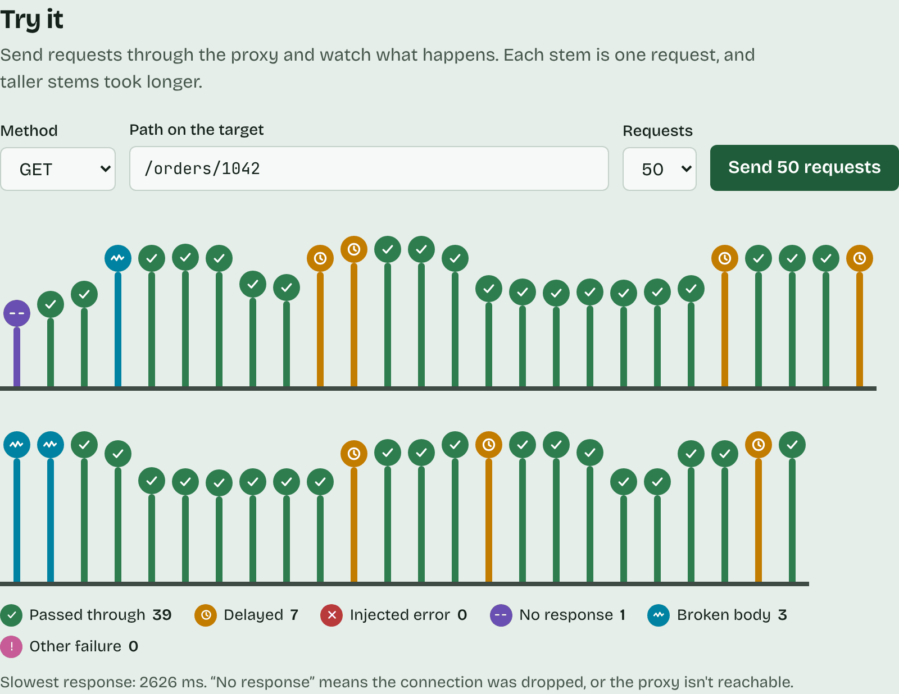
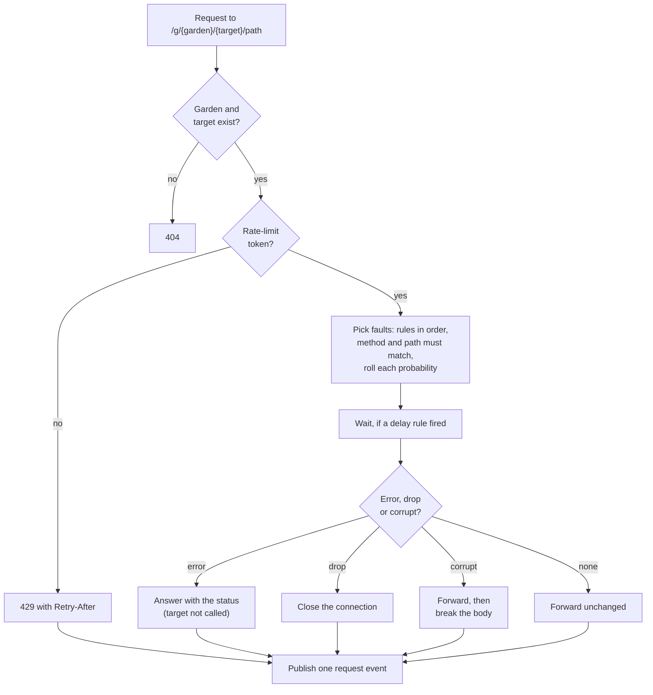
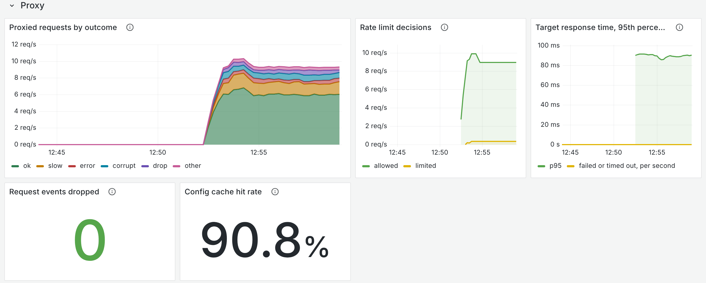

<div align="center">


# Chaos Garden: fault proxy

**The part that breaks things.** It sits between your app and your API, forwards every request, and makes some of them slow, fail, vanish or come back broken, according to the rules you set in [Chaos Garden](https://github.com/georgi4334/Chaos-Garden).

[](https://github.com/georgi4334/chaos-garden-proxy/actions/workflows/ci.yml)




<sub>50 requests through the proxy, sent from the <a href="https://github.com/georgi4334/chaos-garden-web">dashboard</a>. Each stem is one request; taller took longer.</sub>

</div>

## Two implementations, one behaviour

This repository holds the same proxy twice. Both serve the same URLs, faults, headers and metrics, publish the same events and share the same rate-limit buckets in Redis, so either can run in front of the same control API and dashboards.

| | Where | Status |
|---|---|---|
| **Go** | [`go/`](go/README.md) | **The deployed one.** About 4.7× the throughput of the NestJS version on one core, with 7× lower p99 latency and an eighth of the memory |
| **NestJS** | `src/` | The first version, written to learn the concepts in a familiar language |

## Usage

Point your app at the proxy instead of at your API:

```
ANY  http://localhost:3100/g/<gardenId>/<targetName>/<path>?<query>
```

The request goes to the target's base URL + `<path>` + `<query>`, with the method, headers and body unchanged, unless a rule fires. With a rule that returns 503 on some `POST /orders` requests:

```console
$ curl -i -X POST http://localhost:3100/g/<gardenId>/orders-api/orders
HTTP/1.1 503 Service Unavailable
Content-Type: application/json
X-Chaos-Fault: error
X-Ratelimit-Limit: 50
X-Ratelimit-Remaining: 99
X-Request-Id: 51808c68-128b-49aa-8558-174b77276548

{"error":"chaos_garden_injected_error","message":"This error was injected by Chaos Garden","status":503}
```

When no rule fires, you get the target's own response. A request id you send is kept, so you can find the request in the logs later:

```console
$ curl -i -H "x-request-id: checkout-test-0001" http://localhost:3100/g/<gardenId>/orders-api/orders
HTTP/1.1 200 OK
Content-Type: application/json
X-Ratelimit-Limit: 50
X-Ratelimit-Remaining: 98
X-Request-Id: checkout-test-0001

{"orders":[{"id":1041,"status":"shipped"},{"id":1042,"status":"packing"}]}
```

## What happens to a request



| Fault | Effect |
|---|---|
| `latency` `{ ms }` | waits `ms` (at most 30,000), then forwards normally |
| `error` `{ status }` | answers with that status and a JSON body, without calling the target |
| `drop` | closes the connection with no response |
| `corrupt` | forwards, then returns a malformed body (the first half, then junk) |

- A rule applies when its method (or `*`) and path pattern match. In patterns, `*` matches any run of characters and `:name` matches one path segment.
- A matching rule fires with its `probability` (0 to 1).
- At most one `latency` and one of `error`, `drop` or `corrupt` apply per request: the first that fires, in creation order, wins.
- Faulted responses carry an `x-chaos-fault` header, for example `latency,error`.
- The garden's config comes from the control API and is cached for 5 seconds, so rule changes apply within that time.

## Safety

The proxy forwards to URLs that people type in, so by default it refuses loopback, private, link-local and cloud-metadata addresses (SSRF protection). The check runs on the address it actually connects to, so DNS tricks don't get around it. Set `ALLOW_PRIVATE_TARGETS=true` for **local development only**. Request bodies are capped (`MAX_BODY_BYTES`), calls to the target time out (`UPSTREAM_TIMEOUT_MS`), and hop-by-hop headers are stripped.

## Rate limiting

Each garden has its own limit, set in the dashboard and sent by the control API: a token bucket that holds up to `burst` tokens and refills at `rps` per second. Each request takes a token. With none left, the proxy answers **429** with `Retry-After` and `x-chaos-fault: rate_limited`, before any fault or call to the target. Every response carries `x-ratelimit-limit` and `x-ratelimit-remaining`.

The bucket lives in Redis and one Lua script refills and takes atomically, so all proxy instances, Go or NestJS, share one bucket per garden. If Redis is slow (over 250 ms) or down, requests are let through (fail open) and a warning is logged. It needs `REDIS_URL`; turn it off with `RATE_LIMIT_ENABLED=false`.

## Request events

After each proxied request, the proxy appends one event to a Redis Stream (`chaos:requests` by default). The [ingest service](https://github.com/georgi4334/Chaos-Garden/tree/main/ingest) reads it to build request logs and stats. An event holds the garden, target, method, path (without the query string, which can carry secrets), status, duration, the faults applied and the rules that fired. Requests to unknown gardens or targets are not logged.

Publishing is fire-and-forget: if Redis is slow or down, events are dropped and counted, and proxying is never held up. The stream is capped (`EVENT_STREAM_MAXLEN`), so Redis memory stays bounded while the ingest service is stopped. Leave `REDIS_URL` empty to turn events off.

**The contract.** The event format is the request-event v1 JSON Schema, owned by the Chaos-Garden repo and copied into `contracts/`. Both implementations' tests check every event they publish against it, strictly (no undocumented properties). `npm run contract:check`, which CI runs, fails if the copy was edited or differs from Chaos-Garden's `main`; `npm run contract:sync` updates it. To add a field, change the contract in Chaos-Garden first.

## Observability

- **Request ids.** Every request gets an `x-request-id` (a valid incoming one is kept). It is returned to the caller, forwarded to the target and the control API, and stored with the request event, so one id appears in the proxy's, control API's and ingest service's logs.
- **Logs.** `LOG_FORMAT=json` writes one JSON object per line with the request id, plus one access-log line per request.
- **Metrics.** `GET /metrics` for Prometheus: `http_server_requests_seconds` by route template and status, `chaos_proxy_requests_total{outcome}`, `chaos_proxy_rate_limit_decisions_total{decision}`, `chaos_proxy_upstream_seconds{result}`, `chaos_proxy_config_lookups_total{result}`, `chaos_proxy_events_total{result}`, and runtime metrics. No label holds a garden id or path. Set `METRICS_TOKEN` to require a bearer token.

The proxy's part of the Grafana dashboard that ships in [Chaos-Garden's `infra/`](https://github.com/georgi4334/Chaos-Garden/tree/main/infra):



## Go vs NestJS

Pass-through requests to a tiny JSON API, same machine and settings for both, 50 concurrent clients, medians of 3 runs:

| Proxy, 1 CPU core | Requests/s | p50 | p99 | Peak memory |
|---|---:|---:|---:|---:|
| NestJS | 1,464 | 30.2 ms | 109 ms | 207 MB |
| **Go** | **6,862** | **6.2 ms** | **16.2 ms** | **27 MB** |

With two cores, the Go proxy reached 11,200 requests/s in one process. This compares the two implementations, frameworks included, not Node.js and Go in general. The full table, setup, caveats and how to reproduce it are in [go/README.md](go/README.md#benchmark-go-vs-nestjs).

## Development

Run the [control API](https://github.com/georgi4334/Chaos-Garden) (port 3000) first, then create a garden, a target and a rule, in the dashboard or through the API.

**Go:**

```bash
cd go
go run ./cmd/proxy                                       # port 3100, same env vars as below
go test ./...
REDIS_URL=redis://localhost:6379 go test -race ./...     # also the real-Redis tests
```

**NestJS:**

```bash
npm install --legacy-peer-deps   # plain `npm install` crashes in some environments
cp .env.example .env             # INTERNAL_API_KEY must match the control API's
npm run start:dev
npm test                         # unit tests
npm run test:e2e                 # stub control API and target, no database needed
REDIS_URL=redis://localhost:6379 npm run test:e2e   # also the real-Redis event and rate limit tests
```

Both read the same environment variables. Only run one at a time on port 3100, or give the other a different `PORT`.

<details>
<summary><b>Configuration</b></summary>

| Variable | Default | Meaning |
|---|---|---|
| `PORT` | `3100` | proxy port |
| `CONTROL_API_URL` | `http://localhost:3000` | control API base URL |
| `INTERNAL_API_KEY` | none | shared key, sent as `x-internal-key` |
| `ALLOW_PRIVATE_TARGETS` | `false` | allow localhost and private targets (development only) |
| `CONFIG_CACHE_TTL_MS` | `5000` | how long a garden's config is cached (0 turns it off) |
| `UPSTREAM_TIMEOUT_MS` | `10000` | longest wait for the target |
| `MAX_BODY_BYTES` | `1048576` | largest request body |
| `REDIS_URL` | none (events and rate limits off) | Redis for request events and rate limits |
| `EVENT_STREAM` | `chaos:requests` | stream name |
| `EVENT_STREAM_MAXLEN` | `100000` | approximate cap on the stream's length |
| `RATE_LIMIT_ENABLED` | `true` | per-garden rate limiting (needs `REDIS_URL`) |
| `RATE_LIMIT_DEFAULT_RPS` / `RATE_LIMIT_DEFAULT_BURST` | `10` / `20` | used if the control API sends no limit |
| `LOG_FORMAT` | human-readable | `json` for one JSON object per line |
| `METRICS_TOKEN` | none (open) | require a bearer token on `/metrics` |

</details>

<details>
<summary><b>Repository layout</b></summary>

```
.
├── go/                 the Go proxy (the deployed one), see go/README.md
├── src/
│   ├── proxy/          controller and forwarding
│   ├── matching/       path patterns and rule selection
│   ├── faults/         one handler per fault type
│   ├── security/       SSRF checks at connect time
│   ├── rate-limit/     Redis token bucket (Lua)
│   ├── events/         request events to the Redis Stream
│   ├── config/         garden config from the control API, cached
│   └── observability/  request ids, logs, metrics
├── test/               e2e tests: stub control API, local target
├── contracts/          copy of request-event v1 (do not edit here)
└── scripts/            contract check and sync
```

</details>

## Docker and CI

```bash
docker build -t chaos-garden-proxy-go go   # ~10 MB static binary on a distroless image
docker build -t chaos-garden-proxy .       # the NestJS one
```

On every pull request and on `main`, CI checks the contract copy, runs lint, build, unit and e2e tests for NestJS, and `gofmt`, `go vet` and `go test -race` for Go, both with a Redis service container, then builds both images. On `main` it pushes `ghcr.io/georgi4334/chaos-garden-proxy` and `chaos-garden-proxy-go` and, if the `RENDER_DEPLOY_HOOK_PROXY` secret is set, redeploys the Go proxy on Render. The free deploy is described in Chaos-Garden's [DEPLOY.md](https://github.com/georgi4334/Chaos-Garden/blob/main/DEPLOY.md).

## Roadmap

- Scheduled rules ("fail every request between 14:00 and 14:05") and fault bursts.
- More faults: a body that streams slowly, a wrong `Content-Type`, a stale cached response.
- An end-to-end test that runs the same scenarios against both implementations, so they can't drift apart.
